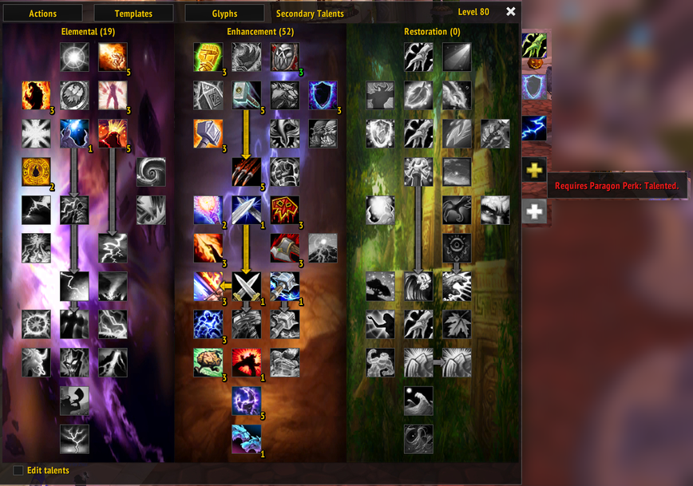

# Talented Rebuffed

WoW 3.3.5a addon. Talented Rebuffed v2.4.8 (Kader Edition) with the five talent specializations of Whitemane Rebuffed.

## Changes

- 2.5.2: no longer hangs when a template holds more talents in a tree than the class has. A template with fewer
  talents in a tree no longer raises a Lua error.
- 2.5.1: spec tabs for all five specializations, tooltips as in the game's talent frame. A locked one opens the
  game's unlock prompt, the fifth needs the Paragon perk Talented. Template menu and glyph frame list every
  unlocked specialization.

## Install

Copy the folder `Talented` into `<WoW folder>\Interface\AddOns`.

## Thanks

Talented is by Jerry. This fork builds on Talented Rebuffed v2.4.8 (Kader Edition).
